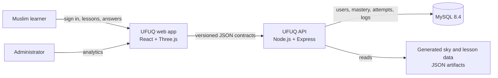
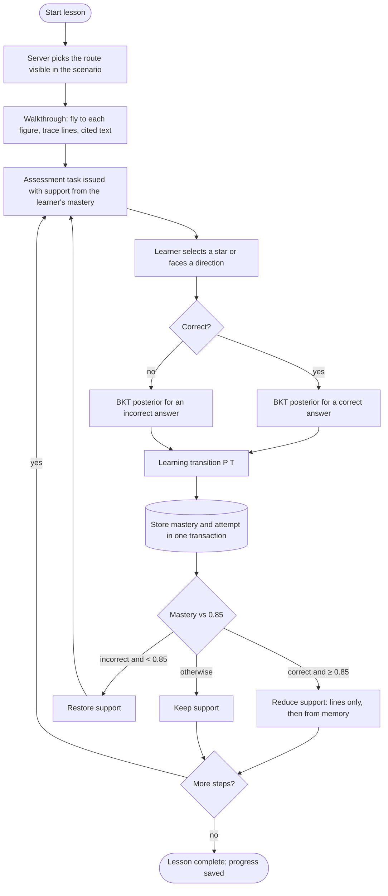
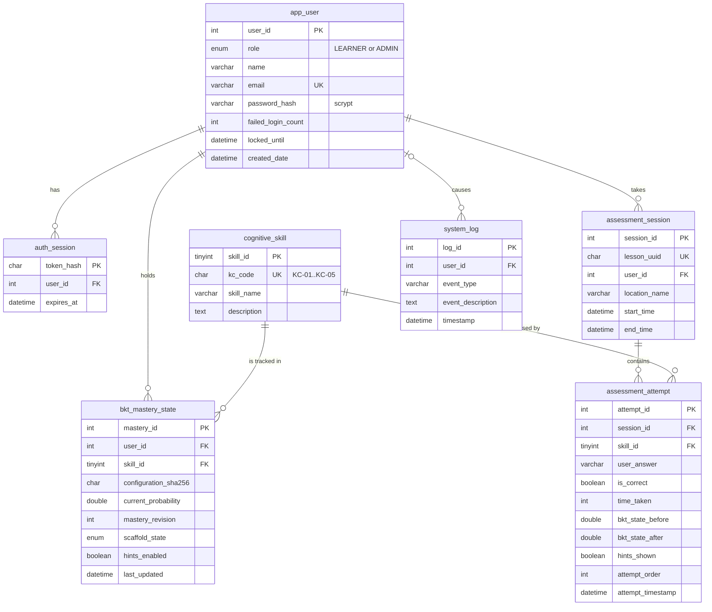

# PSM 2 Evaluation 1 (Supervisor, 20 %): readiness map

Prepared 2026-11-15 for the owner's PSM 2 EV1 supervisor evaluation. The rubric's four
criteria ask whether the project solves the proposed problem, implements the proposed
requirements and the proposed design and data design, and reaches about 70 % of the
proposed development. This page maps each criterion to what runs today, where it is in
the code, and the evidence. Requirement and use-case numbers are the founding report's
(§3.3.3–3.3.4, §3.4.2); `governance/TRACEABILITY.md` holds the full trace.

Everything shown runs on real data in the **review preview**, labelled unreviewed: no
astronomy, cultural, educational or learning value is approved yet (approvals are owner
actions, `data/approvals/README.md`).

## 1. Project development progress: the problem (CLO1, weight 0.4)

The proposal's problem: learners depend on devices for True North and the Qibla. Existing
tools show the answer but do not teach the method, assess it, or adapt support to the
learner's mastery. What now runs:

- the real night sky for UMPSA Pekan at a chosen time, with the Arabic (anwāʾ) star
  figures and their cited explanations;
- a taught walkthrough from a recognisable figure to al-Jady, True North and the Qibla;
- an assessment whose support (lines and names, lines only, nothing) follows each
  learner's BKT mastery per skill, so the learner ends finding north and the Qibla from
  the stars alone;
- stored progress per learner and read-only analytics for administrators.

## 2. Project requirements (CLO1, weight 0.6)

| Requirement (report) | Status | Where | Evidence |
|---|---|---|---|
| FR-1 Scenario rendering (location and time) | Done | `apps/web/src/sky`, `packages/astronomy-core` (SOFA-derived ScientificProfileV1) | `test:reference` (Astropy/PyERFA comparison), e2e |
| FR-2 Dynamic visibility (magnitude, scenario) | Done | display policy (IMP-020), route eligibility (IMP-018) | unit and API tests |
| FR-3 Scenario generation (spatial tasks) | Done | `data/curation/routes`, walkthrough and four assessment steps per route | API tests, e2e |
| FR-4 Input evaluation (pointing the circle at a star, facing direction) | Done | `assessment-core`; circle radius 4% of the field (IMP-025); 15° direction tolerance (owner) | unit, API and e2e tests |
| FR-5 Authentication (registration, login, sessions) | Done | `apps/api/src/accounts` | unit and MySQL integration tests |
| FR-6 BKT probability update | Done, report parameters | `tutoring-core/src/bkt`, `learning-configuration.v1.json` | exact-rational oracle (136 cases), integration |
| FR-7 Adaptive tutoring (lines and highlights by mastery) | Done, report Table 2-5 | scaffold policy and cues | API test, browser run (lines only → from memory) |
| NFR-1 Performance (30 FPS, picking < 100 ms) | Implemented, not yet measured formally | renderer redraws only on change | to measure before EV2 |
| NFR-2 Mathematical accuracy (True North, Qibla by spherical trigonometry) | Done, pending review | spherical Qibla bearing + independent oracle; ScientificProfileV1 | `test:reference` (Qibla 10 cases ≤ 2e-12°) |
| NFR-3 Reliability (mastery logged continuously) | Done | one MySQL transaction per attempt | integration (stale, concurrent, restart) |

Constraints and limitations are stated in `PHASE4_LESSONS_ACCOUNTS_PERSISTENCE.md`
("Not done, and why") and the open approvals in `HANDOFF.md`.

## 3. Proposed design and data design (CLO1, weight 2)

| Design artefact (report) | Implemented as |
|---|---|
| Context diagram (§3.4.1): learner, administrator, system, database, star data | Diagram below; web app, API, MySQL and the static generated sky data |
| Use case diagram and descriptions UC-101 to UC-105 (§3.4.2) | All five run: table below |
| Activity diagram (§3.4.3) | Lesson flow below (walkthrough → assessment → BKT → support) |
| BKT flowchart (§3.4.4) | `processAttempt` in `tutoring-core/src/learner-model.ts`: observation, posterior, transition, store, compare with 0.85, decide support |
| Storyboard (§3.4.5) | Figure 3-5 = walkthrough; 3-6 = lines only; 3-7 = from memory; 3-8 = feedback panel |
| ERD (§3.5.1) and data dictionary tables 3-7 to 3-12 (§3.6) | MySQL migration 1: diagram below |
| Static JSON star data (§3.3.2) | Generated artifacts in `data/generated` with checksums and approvals |

| Use case | Basic flow | Alternative / exception flows |
|---|---|---|
| UC-101 Manage authentication | Register or sign in; session cookie; role loaded | A1 invalid credentials (same answer for unknown email); E1 lock after 5 failures for 15 minutes |
| UC-102 Manage celestial environment | Sky for scenario or chosen time; rotate, pan, zoom | A1 change time or scenario; E1 load failure message |
| UC-103 Manage spatial assessment | Task, selection or facing direction, server scoring, feedback, BKT update | A1 incorrect → corrective feedback and restored guidance; E1 connection failure (stale-revision reissue; local caching is not built) |
| UC-104 Manage progress dashboard | Own mastery per skill, support level, answers, sessions | A1 "No data available" with a start-lesson shortcut; E1 load error message |
| UC-105 Manage system analytics | Totals, per-skill mastery, answers per day, system log | A1 "No activity recorded yet"; E1 load error; strictly read-only, administrators only |

**Deviations from the report's data design (to state in the thesis):** `USER` is
`app_user` (a reserved word); probabilities are DOUBLE, not FLOAT (single precision would
lose the BKT reference precision); `bkt_mastery_state` adds the configuration hash, the
revision and the support state so a learner model is never continued under different
parameters; `auth_session` and `schema_migration` are added.

## 4. Development progress, 70 % (CLO2, weight 1)

| Component of the proposed design | State |
|---|---|
| 3D sky rendering, projections, navigation, catalogue pipeline | Done |
| Arabic star culture, names, cards, references | Done, pending cultural review |
| Lessons: walkthrough, four-step assessment, two routes, Qibla | Done, pending educational review |
| BKT engine and adaptive scaffolding (report values) | Done, pending BKT-001..005 approval |
| Persistence (MySQL), accounts, dashboard, analytics | Done |
| Evaluation instruments (pre-test, post-test, SUS), idempotent retries, deployment | Not started (later phases) |

Against the proposal's design, the system, data and use-case artefacts are all
implemented. The remaining work is evaluation, hardening and approvals, consistent with
"at least 70 % development progress".

## Demo script for the supervisor (about 10 minutes)

Set up once with `npm run db:local -- init`. Before the demo, run `npm run preview:review`
(it starts MySQL, creates the demo accounts and starts the servers) and open
http://127.0.0.1:4173; the real sky is the default.

1. **UC-102:** drag, zoom and change the projection. Open the Dhāt al-Kursī card and its
   references.
2. **UC-101:** Sign in with the demo learner `user1@ufuq.test` (password `1234567`) or Sign
   in / Register → create an account (8 or more characters). Show the locked-account message
   after five wrong passwords on a second account, if wanted.
3. **Walkthrough:** Start lesson. Step through: Dhāt al-Kursī → Kawkabā al-Firq → guide
   line → al-Jady → True North → the Qibla (292° 07′).
4. **Assessment, lines only:** drag the sky until the circle is on Dhāt al-Kursī, then on
   al-Jady, then face north and the Qibla.
   Then show a wrong answer: the support returns to guided with names.
5. Repeat the lesson: after two correct answers per skill the support becomes "From
   memory: no lines and no names".
6. **UC-104:** My progress: mastery per skill (20 % → 58 % → 87 % → 97 %), the support
   level, and each answer with mastery before and after.
7. **UC-105:** sign in as an administrator (`admin1@ufuq.test`, password `1234567`) →
   Analytics: totals, per-skill mastery, answers per day, the system log (read-only).
8. **Evidence:** `npm run test:integration` (real MySQL), `npm run test:reference` (BKT
   and Qibla oracles), and the e2e suite.
